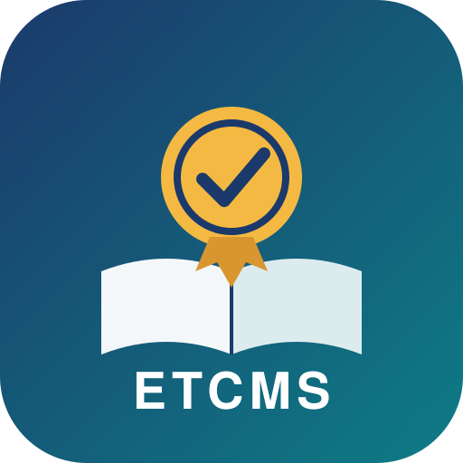

# Employee Training & Certification Management System (ETCMS)

## Project Overview
A custom scoped ServiceNow application that helps an organisation manage employee training courses, scheduled sessions, enrolments and professional certifications — replacing spreadsheets and email with a single platform.

## Objectives
- Centralise employee training records.
- Manage training courses and sessions.
- Track employee enrolments and completion.
- Maintain certification records.
- Provide visibility into training activities.

## Technology
- ServiceNow Platform — Personal Developer Instance (PDI), release: Zurich (PDI dev407572)
- App Engine Studio / Table Builder
- Tables, Dictionary, Choice lists
- Reference fields and Related lists
- Flow Designer (planned)
- Reporting and Dashboards (planned)

## Application Architecture
Four custom tables inside the scope `x_2186817_employ_0_` (see [docs/architecture.md](docs/architecture.md)):

1. Training Course
2. Training Session → references Training Course and Trainer (`sys_user`)
3. Course Enrollment → references Training Session and Employee (`sys_user`)
4. Employee Certification → references Employee (`sys_user`)

Existing ServiceNow User records are referenced for employees and trainers; no separate Trainer table is created.

## Implementation
| Phase | Scope | Status |
|-------|-------|--------|
| 1 | Application and data model | ✅ Complete (2026-10-30) |
| 2 | Forms, lists and related lists | ✅ Complete (2026-10-30) |
| 3 | Sample data and testing | ✅ Complete (2026-10-31) |
| 4 | Business logic and automation | 🟡 In progress |
| 5 | Reports, dashboards and documentation | ⬜ Not started |

Step-by-step notes, with screenshots, live in [docs/development-log.md](docs/development-log.md).

## Testing
See [docs/test-cases.md](docs/test-cases.md).

## Key Learnings
See the *Concepts learned* column in the development log and the issue log in [docs/development-log.md](docs/development-log.md#issue-log).

## Future Enhancements
- Automated enrolment approvals (Flow Designer).
- Certification expiry reminders (scheduled flow + notification).
- Training analytics dashboard.
- Improved application security (ACLs per role).

## Demo environment

The PDI is branded as a fictional customer, **Novatrix Solutions** (primary company record, logo and header colours), so screenshots read like a real tenant. Brand assets are in `brand/`.

## Project Status
Personal Developer Instance prototype. Features are marked *implemented* only after they have been built and tested.
