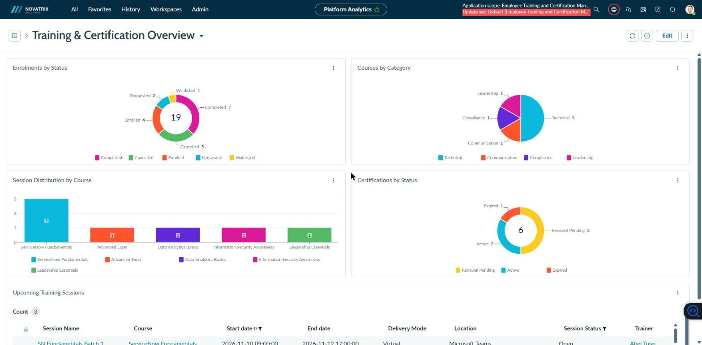
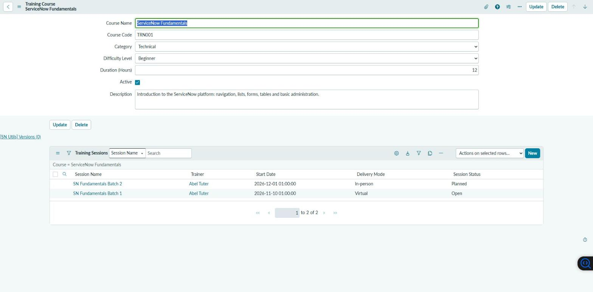
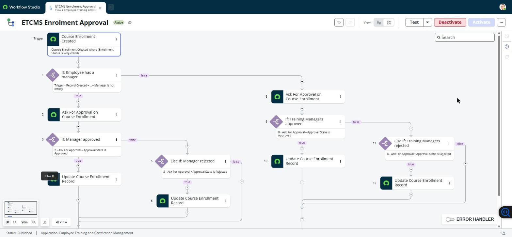
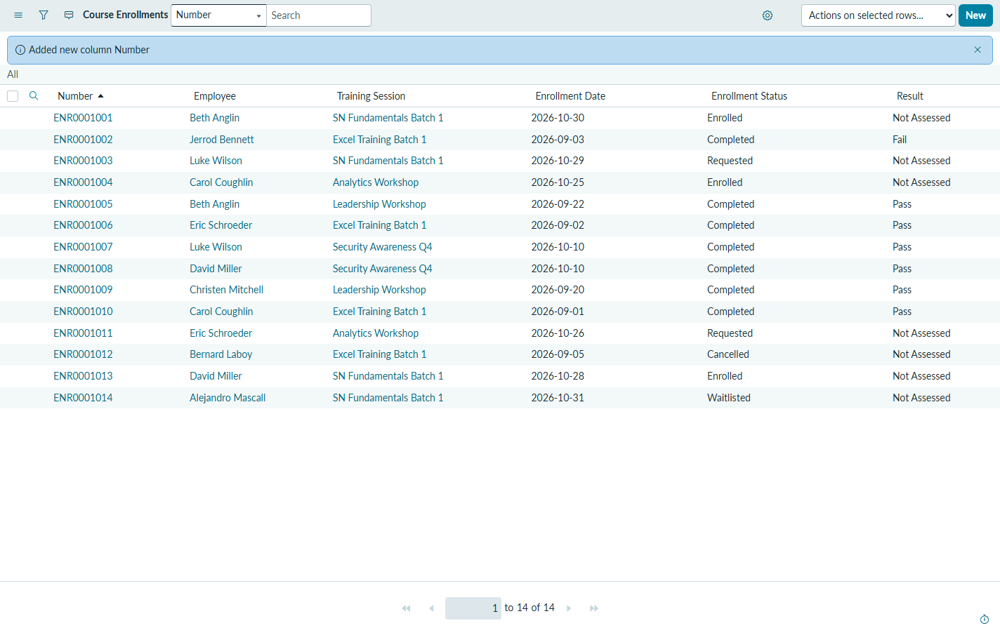
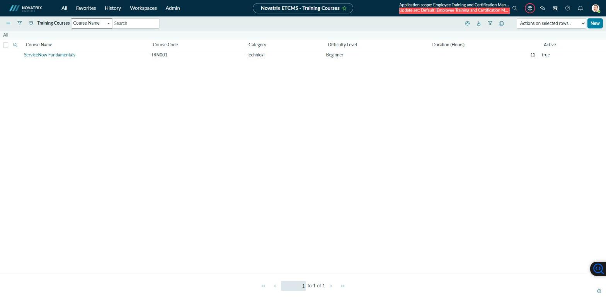

# Employee Training & Certification Management System (ETCMS)

*The Platform Analytics dashboard training managers open each morning: enrolments, courses, sessions and certifications from live app data.*

**Author:** Sparsh Varde ([@sparsh17max](https://github.com/sparsh17max))

## Project Overview
A custom scoped ServiceNow application that helps an organisation manage employee training courses, scheduled sessions, enrolments and professional certifications, replacing spreadsheets and email with a single platform. It runs in a Personal Developer Instance (release Zurich) branded as a fictional customer, **Novatrix Solutions**.

## What I built
- **Data model:** 4 custom tables, 31 fields and 25 choice values in the scope `x_2186817_employ_0` ([data dictionary](docs/data-dictionary.md)).
- **Relationships:** 5 reference fields linking courses, sessions, enrolments and the platform's `sys_user` table, surfaced as related lists ([architecture](docs/architecture.md), [screenshot](screenshots/course-related-list-two-sessions.jpg)).
- **Form logic:** 1 UI Policy, 1 onSubmit Client Script and 1 before Business Rule that enforce session dates and completion data on every entry path ([client script](screenshots/client-script-end-date-blocked.png), [business rule](screenshots/business-rule-completed-blocked.png)).
- **Auto-numbering:** enrolments numbered ENR0001001 onwards and used as the display value everywhere ([screenshot](screenshots/enrollment-list-number-column.png)).
- **Notifications:** 4 email notifications plus 2 daily scheduled jobs for session and certification-expiry reminders ([notifications](screenshots/notifications-list.png), [outbox](screenshots/notification-outbox.png)).
- **Approval flow:** 1 Flow Designer flow that routes each enrolment request to the employee's manager, falls back to a Training Managers group, and sets the status on approval or rejection ([flow](screenshots/flow-enrolment-approval.png), [approval](screenshots/flow-approval-record.png)).
- **Reporting:** 5 reports combined into a Platform Analytics dashboard shared with the Training Managers group ([dashboard](screenshots/dashboard-training-overview.png), [reports](screenshots/reports-list.png)).
- **Testing:** 19 of 19 test cases passed, each with the date and the observed result ([test cases](docs/test-cases.md)).

## Application Architecture
Four custom tables (see [docs/architecture.md](docs/architecture.md)):

1. Training Course
2. Training Session → references Training Course and Trainer (`sys_user`)
3. Course Enrollment → references Training Session and Employee (`sys_user`)
4. Employee Certification → references Employee (`sys_user`)

Existing ServiceNow User records are referenced for employees and trainers, so no separate Trainer table is needed.

## Technology
- ServiceNow Platform, Personal Developer Instance, release Zurich
- App Engine Studio, tables, dictionary and choice lists
- Reference fields, related lists and form views
- UI Policies, Client Scripts, Business Rules
- Notifications, events and Scheduled Script Executions
- Flow Designer (Workflow Studio)
- Reporting and Platform Analytics dashboards

## Implementation
| Phase | Deliverable | Status |
|-------|-------------|--------|
| 1 | Application and data model | ✅ Complete (2026-10-30) |
| 2 | Forms, lists, related lists and views | ✅ Complete (2026-10-30) |
| 3 | Sample data and testing | ✅ Complete (2026-10-31) |
| 4 | Business logic, automation, approval flow, reports and dashboard | ✅ Complete (2026-11-02) |
| 5 | Portfolio documentation: GitHub repo, Notion tracker, demo video | 🟡 In progress: repo and tracker done, demo video not yet recorded |
| 6 | Security: ACLs per role (employee, trainer, training manager) | ⬜ Planned |

Step-by-step notes, with screenshots, live in [docs/development-log.md](docs/development-log.md).

## Screenshots
| | |
|---|---|
|  **Course form** with its Training Sessions related list |  **Approval flow** in Flow Designer |
|  **Enrolment list** with ENR auto-numbers |  **Branded header** for the fictional customer Novatrix Solutions |

## How this was built
I built the application hands-on in my own ServiceNow Personal Developer Instance. I used AI assistance (Claude) to write and run configuration scripts against the instance and to draft the documentation, and I reviewed and tested each change in the instance before marking it complete. The [development log](docs/development-log.md) is the evidence of the problem-solving: every step records what was built, why, what was learned and which issues came up, such as a flow that ignored rejections and notifications that silently never fired. The reproducible scripts are in [scripts/](scripts/README.md).

## Testing
See [docs/test-cases.md](docs/test-cases.md).

## Key Learnings
See the *Learned* notes and the issue tables in [docs/development-log.md](docs/development-log.md#issue-log).

## Future Enhancements
- Convert the two daily reminder Scheduled Jobs to scheduled flows.
- Employee self-service portal page for enrolment requests.

## Demo environment
The PDI is branded as a fictional customer, **Novatrix Solutions** (primary company record, logo and header colours), so screenshots read like a real tenant. Brand assets are in `brand/`.

## Project Status
Personal Developer Instance prototype. Features are marked *implemented* only after they have been built and tested.
