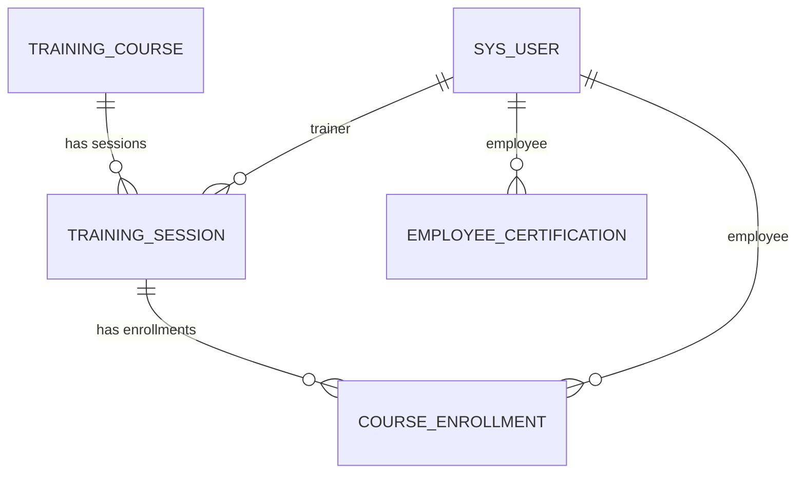

# Application Architecture

Scope: `x_2186817_employ_0_` (fill in from App Engine Studio → app settings)

## Relationships
| Parent / reference table | Related table | Relationship | Implemented via |
|--------------------------|---------------|--------------|-----------------|
| Training Course | Training Session | One-to-many | `course` reference field |
| Training Session | Course Enrollment | One-to-many | `training_session` reference field |
| User (`sys_user`) | Course Enrollment | One-to-many | `employee` reference field |
| User (`sys_user`) | Employee Certification | One-to-many | `employee` reference field |
| User (`sys_user`) | Training Session | One-to-many | `trainer` reference field |

## Design decisions
- **No Trainer table.** Trainers are users; a separate table would duplicate employee data.
- **No Course field on Enrollment.** The session already identifies its course; storing it twice invites inconsistency.
- **Employee Certification is independent of courses.** Certifications may be earned outside this application.

## Roles
| Role | Purpose |
|------|---------|
| `x_2186817_employ_0_.admin` | Full access to the application |
| `x_2186817_employ_0_.user` | Create and view own enrolments / certifications |
